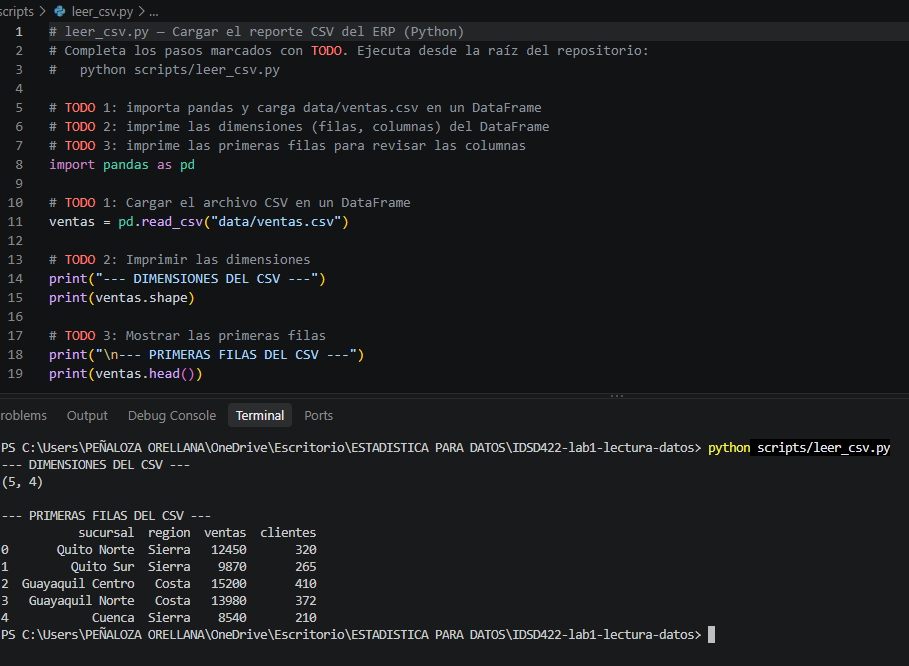
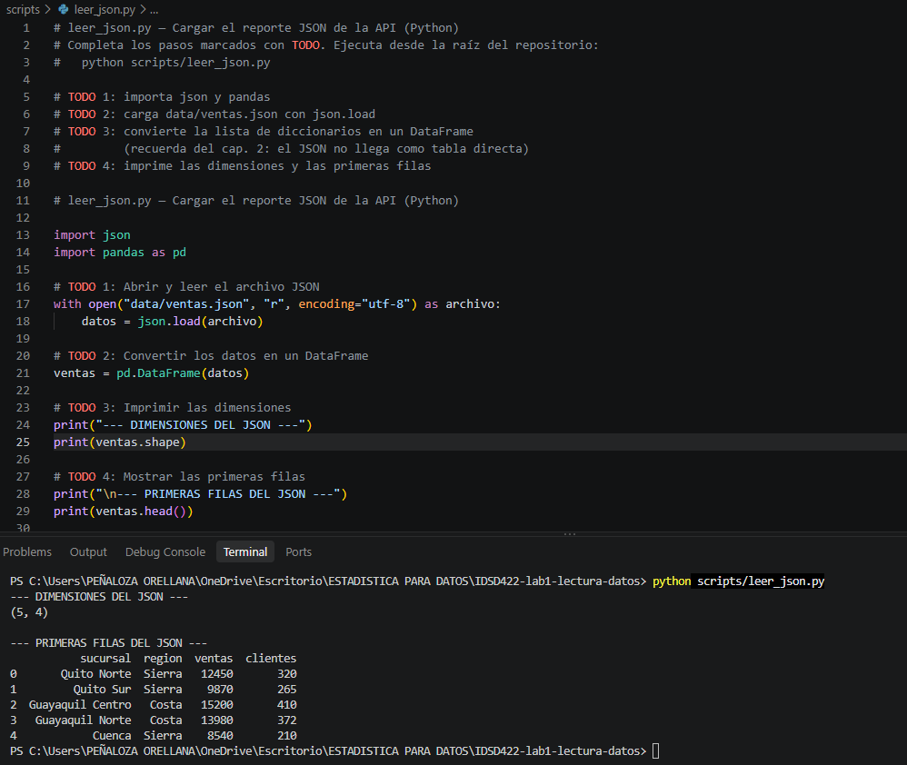
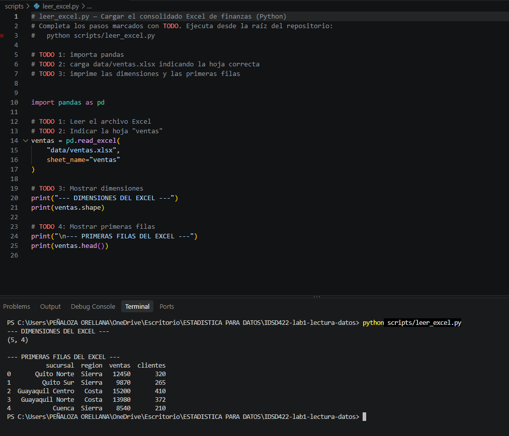
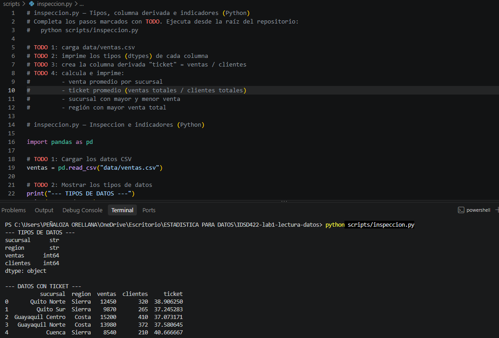
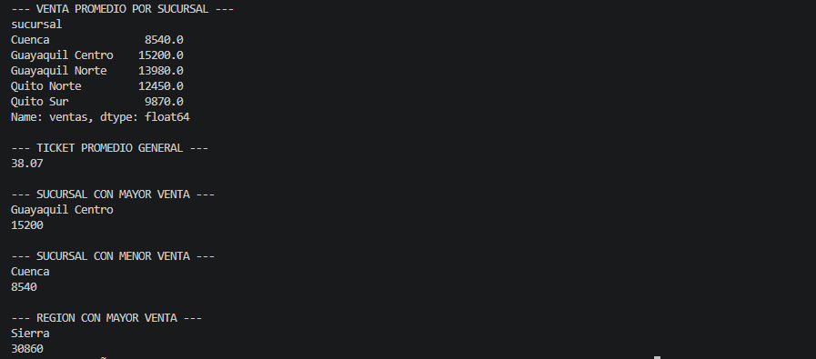
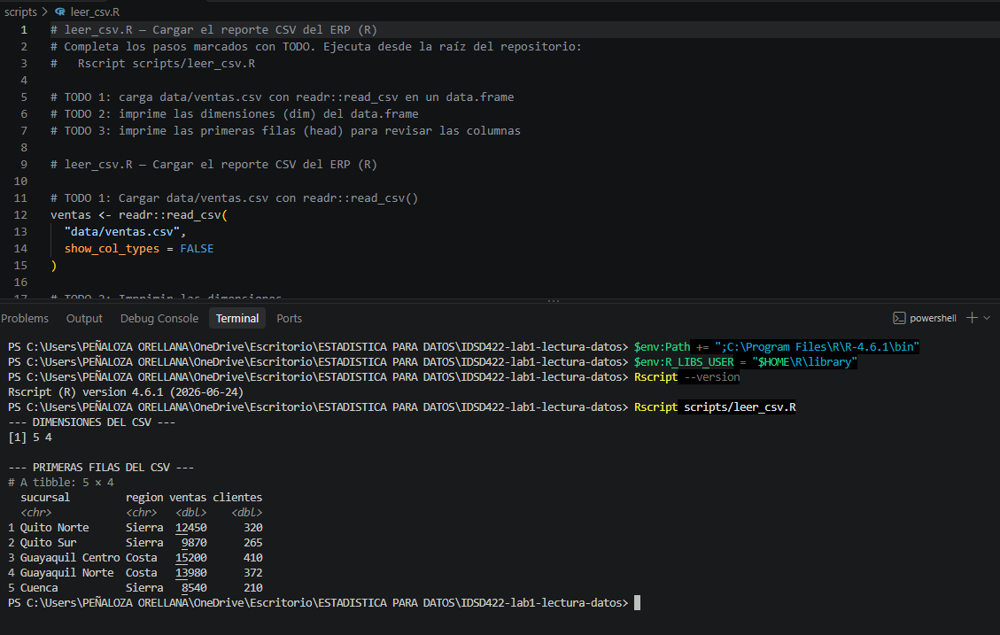
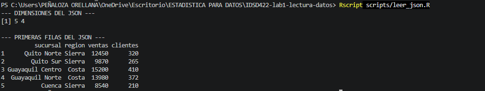
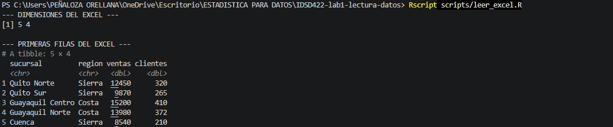
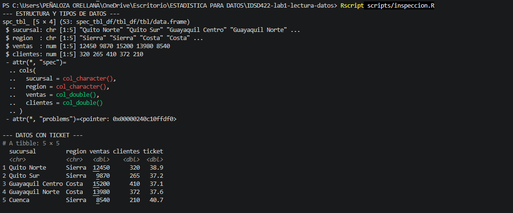
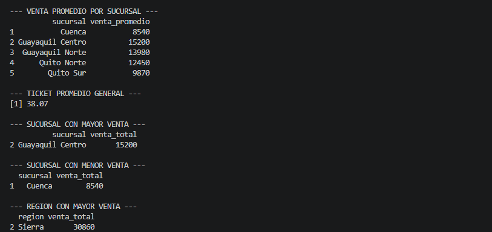

# Informe técnico — Consolidación de reportes de ventas

**Para:** Gerencia de RetailAndina S.A.  
**De:** Equipo de Business Intelligence  
**Asignatura:** IDSD422 — Estadística y Programación para Ciencia de Datos I  
**Estudiante:** [Completar nombres y apellidos]  
**Docente:** [Completar]  
**Fecha:** [Completar fecha]  
**Asunto:** Análisis inicial de ventas de la semana 39  
**Repositorio (fork):** https://github.com/Tabatha-Orellana/IDSD422-lab1-lectura-datos

## Resumen ejecutivo

Analicé los reportes de ventas de RetailAndina S.A. en CSV, JSON y Excel mediante Python y R desde Visual Studio Code. Los tres archivos contenían cinco registros y cuatro columnas con los mismos valores. Las ventas totales fueron 60.040 para 1.577 clientes, con un ticket promedio general de 38,07. Guayaquil Centro presentó la mayor venta por sucursal y Sierra lideró el total regional. Recomendé mantener un esquema uniforme y validar los datos antes de consolidar futuros reportes.

## 1. Introducción y objetivos

RetailAndina S.A. recibe información semanal desde un ERP de sucursales, una API de fidelización y un consolidado de Finanzas. Aunque la información llega en formatos distintos, la gerencia necesita verificar su consistencia antes de utilizarla en decisiones comerciales.

**Objetivo general:** analizar los reportes de ventas de la semana en Python y R para verificar su contenido y obtener indicadores iniciales.

**Objetivos específicos:** (1) leer los tres formatos; (2) comprobar filas, columnas y tipos de datos; (3) calcular e interpretar los indicadores comerciales; y (4) documentar resultados reproducibles.

## 2. Desarrollo de la práctica

### 2.1. Lectura del CSV, JSON y Excel

Ejecuté `leer_csv.py`, `leer_json.py` y `leer_excel.py` desde la raíz del repositorio. Utilicé pandas para el CSV y Excel, y `json.load()` junto con `pd.DataFrame()` para los registros JSON. También realicé las lecturas equivalentes en R con `readr`, `jsonlite` y `readxl`.

| Formato | Sistema | Filas | Columnas | Lectura utilizada |
|---|---|---:|---:|---|
| CSV | ERP de sucursales | 5 | 4 | `pd.read_csv()` / `readr::read_csv()` |
| JSON | API de fidelización | 5 | 4 | `json.load()` + `pd.DataFrame()` / `jsonlite::fromJSON()` |
| Excel | Finanzas | 5 | 4 | `pd.read_excel(sheet_name="ventas")` / `readxl::read_excel(sheet="ventas")` |

*Figura 1. Lectura del archivo CSV en Python mediante pandas, con cinco filas y cuatro columnas.*

*Figura 2. Lectura del archivo JSON en Python y conversión de sus registros a un DataFrame.*

*Figura 3. Lectura del archivo Excel en Python, seleccionando la hoja `ventas` y comprobando sus dimensiones.*

La inspección mostró que los tres formatos representaron los mismos valores de `sucursal`, `region`, `ventas` y `clientes`. Las diferencias en su almacenamiento no alteraron estos registros.

### 2.2. Tipos de datos y calidad

En Python inspeccioné `dtypes`; en R, `str()`. Estos fueron los tipos para el CSV (en R se muestra la inferencia habitual de `readr`, que debe verificarse con la captura real):

| Variable | Python | R (`readr`) | Interpretación |
|---|---|---|---|
| `sucursal` | `object` | `chr` | Texto |
| `region` | `object` | `chr` | Texto |
| `ventas` | `int64` | `dbl` | Importe numérico |
| `clientes` | `int64` | `dbl` | Recuento numérico |

Si `ventas` o `clientes` se hubieran interpretado como texto, habría revisado símbolos, separadores y valores inconsistentes. La inspección y la nueva columna `ticket` se respaldan en las figuras 4 y 9 de los anexos.

### 2.3. Indicadores comerciales

Ejecuté `inspeccion.py` e `inspeccion.R`, agrupé los registros por sucursal y región, y calculé el ticket general mediante `sum(ventas) / sum(clientes)`.

| Indicador | Resultado |
|---|---|
| Promedio por sucursal | Quito Norte: 12.450; Quito Sur: 9.870; Guayaquil Centro: 15.200; Guayaquil Norte: 13.980; Cuenca: 8.540 |
| Ticket promedio general | 38,07 |
| Sucursal con mayor venta | Guayaquil Centro — 15.200 |
| Sucursal con menor venta | Cuenca — 8.540 |
| Región con mayor venta | Sierra — 30.860 |

Las ventas totalizaron **60.040** y los clientes **1.577**. Como solo existe un registro por sucursal, el promedio por sucursal coincide con el valor observado. Los resultados de Python y R se documentan en las figuras 5 y 10 de los anexos.

### 2.4. Respuestas a las cinco preguntas

**1. ¿Cuántas filas y columnas tiene cada formato? ¿Fue igual en los tres? ¿Por qué?**  
Cada archivo contiene cinco filas y cuatro columnas. Los registros tienen los mismos valores; cambia el formato en el que los sistemas almacenan y entregan la información.

**2. ¿Qué tipos se infirieron para ventas y clientes? ¿Qué indicaría que aparecieran como texto?**  
En Python se infirieron como `int64`. En R, `readr` los puede presentar como `dbl`. Si aparecieran como texto, podría deberse a caracteres o formatos incompatibles que necesitan limpieza antes de calcular.

**3. ¿Qué devuelve `json.load()` y por qué hay que aplanarlo?**  
Devuelve una estructura Python según el contenido del JSON; en este archivo, una lista de diccionarios. La convertí en un DataFrame para trabajar con filas y columnas. Si hubiera objetos anidados, sería necesario normalizar los campos internos.

**4. ¿Para qué sirve `sheet_name` / `sheet` al leer Excel?**  
Para seleccionar la hoja correcta del libro. En ambos lenguajes indiqué la hoja `ventas`.

**5. ¿Qué diferencias observé entre leer en Python y R?**  
Ambos permitieron importar y analizar los mismos registros. En Python trabajé con DataFrames de pandas; en R, con data frames o tibbles y funciones del entorno estadístico. Los resultados numéricos fueron equivalentes.

## 3. ¿Qué aprendí con esta práctica?

Durante esta práctica aprendí a leer y analizar archivos CSV, JSON y Excel mediante Python y R desde Visual Studio Code. Comprendí que es importante verificar las dimensiones y los tipos de datos antes de calcular indicadores, porque un archivo puede abrirse correctamente y aun así contener valores con formatos inadecuados. También entendí cómo transformar los registros JSON en una tabla y por qué debo elegir explícitamente la hoja adecuada cuando trabajo con Excel.

Mi principal dificultad fue configurar los entornos de ejecución. Al principio, Python no encontraba `pandas`; después tuve inconvenientes con la ubicación del proyecto y las rutas relativas. En R, PowerShell no reconocía `Rscript` y fue necesario configurar su ruta, resolver los permisos de instalación de bibliotecas y completar algunas dependencias. Solucioné estos problemas comprobando las rutas, instalando los paquetes en mi carpeta de usuario y probando los scripts uno por uno.

Además, aprendí a utilizar GitHub de manera más organizada. Al principio trabajé en una carpeta extraída de un ZIP que no tenía información de Git; posteriormente cloné mi fork, trasladé los scripts terminados y registré los cambios con commits separados. En una próxima práctica comprobaría desde el inicio el directorio de trabajo, las dependencias y la conexión con GitHub. Así reduciría errores y tendría un proceso más ordenado y reproducible.

## 4. Conclusiones y recomendación

1. Confirmé que CSV, JSON y Excel contenían los mismos cinco registros y cuatro columnas, por lo que fue posible analizar el reporte sin alterar sus valores.
2. Verifiqué que `ventas` y `clientes` se podían tratar como datos numéricos y calculé un ticket promedio general de **38,07**.
3. Identifiqué a **Guayaquil Centro** como la sucursal con mayor venta (**15.200**) y a **Sierra** como la región líder (**30.860**). Estos resultados describen solo el período analizado, no permiten hacer proyecciones.

**Recomendación para gerencia:** estandarizar nombres de columnas y tipos de datos; comprobar consistencia, valores faltantes y formatos antes de consolidar reportes provenientes de diferentes sistemas.

## 5. Bibliografía

- pandas development team. (s. f.). *pandas.read_csv*. https://pandas.pydata.org/docs/reference/api/pandas.read_csv.html
- pandas development team. (s. f.). *pandas.read_excel*. https://pandas.pydata.org/docs/reference/api/pandas.read_excel.html
- Wickham, H., Hester, J. y Bryan, J. (s. f.). *readr*. https://readr.tidyverse.org/
- Ooms, J. (s. f.). *jsonlite*. https://cran.r-project.org/package=jsonlite
- Escuela Politécnica Nacional. (2026). *Laboratorio 1: Consolidación de reportes de ventas* [Material de clase, IDSD422].

**Declaración de uso de IA:** Utilicé ChatGPT como apoyo para explicar errores técnicos y organizar la redacción del informe. Ejecuté los scripts en Visual Studio Code y reuní personalmente las capturas que respaldan los resultados.

## 6. Anexos — Evidencias de ejecución

Las siguientes capturas complementan el procedimiento descrito en el desarrollo y deben corresponder a ejecuciones reales de los scripts.

### Anexo A. Inspección y resultados en Python

*Figura 4. Inspección de tipos de datos y creación de la columna `ticket` en Python.*

*Figura 5. Cálculo del ticket promedio general y de los indicadores comerciales en Python.*

### Anexo B. Lectura de datos en R

*Figura 6. Lectura del reporte CSV mediante `readr` en R, comprobando cinco filas y cuatro columnas.*

*Figura 7. Lectura del archivo JSON mediante `jsonlite` y conversión a un data frame en R.*

*Figura 8. Lectura del archivo Excel mediante `readxl`, seleccionando la hoja `ventas`.*

### Anexo C. Inspección y resultados en R

*Figura 9. Inspección de la estructura de datos y creación de la columna `ticket` en R.*

*Figura 10. Cálculo de indicadores comerciales en R para contrastar los resultados obtenidos en Python.*
